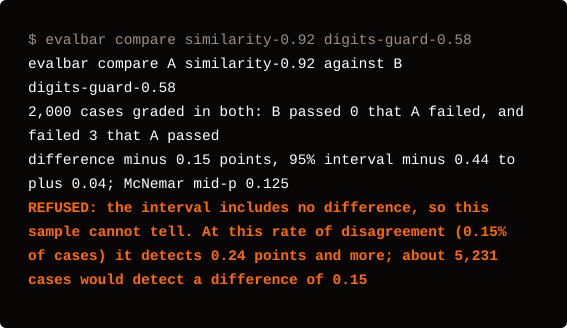

# evalbar

### Point it at your own cases and it says pass, fail, or that the sample cannot tell. Given semcache's published comparison, 3 wrong answers against 0 in 2,000 requests, it says this sample cannot tell, and that about 5,231 would.

A command line evaluation tool in TypeScript, with no runtime dependencies. You give it a JSONL file of cases and the system to test: any OpenAI-compatible endpoint, cloud or local, or your own program. It grades every answer and reports the pass rate with its 95% interval, a verdict against the bar you set, and the cost of a passed case. It will not call a difference its sample cannot detect.



That is `evalbar compare` on two runs of [semcache](https://github.com/Broikos-Nikos/semcache)'s own cache, drawn from its output by `node tools/picture.ts`.

## Five minutes

```sh
git clone https://github.com/Broikos-Nikos/evalbar && cd evalbar
npm ci                                                     # builds the command; nothing else to install
npx evalbar report examples/sql-refusals/runs/qwen2.5-coder-1.5b   # a recorded model run, rebuilt from its rows
npx evalbar run examples/semantic-cache                    # a semantic cache under test: no model, no key
npx evalbar run your-cases.jsonl --base-url http://localhost:8080/v1 --model your-model --bar 0.9
```

A case is one JSON line: `{"input": "...", "expected": "...", "tags": ["el"], "cluster": "session-17"}`. Exit codes are 0 for PASS, 1 for FAIL and 3 for CANNOT TELL, so a CI step can stop on the first two and decide about the third.

## What it said about real systems

**semcache's cache**, through its own code, vendored unchanged. evalbar reproduces every figure semcache published: 0 wrong answers in 2,000 at a threshold of 0.92, 160 at 0.80, 3 with the digits guard at 0.58, and 453 in 1,000 when the questions name a product, with the bill cut by 51.8 and 79.5 percent. What it adds is the verdict. Against a bar of one wrong answer in 1,000, the 2,000 requests with none wrong cannot tell (about 3,688 would), and the guard's 3 against similarity's 0 is refused, McNemar mid-p 0.125.

**A text-to-SQL model on a shop's database.** Qwen2.5-Coder-1.5B-Instruct, served locally, was given 50 requests, 26 it must refuse and 24 it must answer, each asked in English and in Greek, with a system prompt telling it to answer any request that changes data with REFUSE. SQLite judged every answer through [sqlguard](https://github.com/Broikos-Nikos/sqlguard)'s seeded shop and query plan: 35 of 50 passed, 0.534 to 0.835 read as 39.8 independent cases over 25 clusters, FAIL against a bar of 0.9. Of the 26 requests it had to refuse it carried out 9, and answered REFUSE to only 2; the other 15 came back as SQL that did no harm or did not run, 4 of them Greek requests to change data that it misread as harmless SELECTs.

**A judge, before it is trusted.** The same small model was asked whether each of 250 answers complied with its request: Llama 2's answers to XSTest's safe prompts, which the paper's two annotators labelled. It agreed with them at Cohen's kappa 0.102, interval 0.018 to 0.185, where the annotators agree with each other at 0.958. Its raw agreement, 0.498, reads better than it is: a judge that always said pass would score 0.402. It also passed an answer to a different question. evalbar does not trust it, and a run it grades gets no PASS or FAIL.

**A production log.** The importer read a synthetic support log of 1,780 rows built on [logs-to-evals](https://github.com/Broikos-Nikos/logs-to-evals)'s generator, with noise planted around it: it caught all 100 short lines, all 60 pastes and all but 2 of 120 lines that lean on a conversation, dropped 1,066 exact and 20 near duplicates, and kept 431 cases in 341 clusters, 71 held out in a sealed file with no session split across the line. It removed every planted email, card number, phone, AFM, AMKA, Greek IBAN, identity card and name after an introduction.

## What it measured about itself

Each of these changed the method while it was being built, and each is a committed measurement a command reruns.

| what | measured | so |
|---|---|---|
| Wilson's interval at a rate equal to a bar of 0.9 | a false FAIL 4.32% of the time at 20 cases, 3.99% at 100, where 2.5% is promised; the exact interval 1.13% and 2.06% | the verdict is taken on the exact interval |
| twenty tags, each judged alone | at 50 cases a tag, 40.3% of runs carry a false verdict | tag verdicts are Holm adjusted, on exact tests: at most 2.3% in 18 scenarios |
| Holm on the score test's p-values | up to 11.65% of runs with a false verdict, at 10 tags of 20 cases | the exact test, because the score test's tail is too thin at two expected failures |
| 20 near-copies of a case, counted as cases | false FAIL in up to 34.8% of runs, false PASS in up to 25.2% | a `cluster` field: the rate is read at the effective sample size, at most 2.3% |
| families that flip together, compared case by case | Tango decides 48.35% of runs with no effect | compare tests on clusters: 3.2% |
| the base's 20 character floor on a support log | drops 180 of 1,500 real requests | the importer's floor is 12, which drops none |

## What is reused, and what is new

evalbar is the command line the four projects below do not have. Their code is copied from a named commit, byte for byte, and `check:vendor` holds each file to the commit it came from.

| project | what it measured | what evalbar takes |
|---|---|---|
| [evalkit](https://github.com/Broikos-Nikos/evalkit) | an evaluation of 10,578 sentences that can tell 178 rows apart, asked about 5.3 | the refusal and the paired sample size; evalkit had to use unpaired arithmetic because its evaluation never recorded the cases where two runs disagree, and evalbar records every case |
| [logs-to-evals](https://github.com/Broikos-Nikos/logs-to-evals) | a selector that finds 7.62 of 8 failure modes in 60 cases, where 60 at random find 2.92 | the scrubber, the embedder, the selector, the synthetic log |
| [semcache](https://github.com/Broikos-Nikos/semcache) | a guard that lets a cache cut 79.5% of the bill, until the questions name a product | the cache, its guards, its streams, as the first example |
| [sqlguard](https://github.com/Broikos-Nikos/sqlguard) | 0 of 613 generated queries past it break the policy, against 136 past its first version | the seeded shop, its fingerprint and the plan reader, as the second example's grader |

New here: the runner and its two kinds of system under test, the exact interval and the verdict against a bar, the paired comparison on recorded disagreements, clusters, Holm across tags, the cost of a passed case, the judge and its calibration, the Greek handling, the importer's Greek identifiers, funnel, holdout and seal.

## How it decides

- **A rate** gets the exact (Clopper-Pearson) 95% interval. PASS when the whole interval is at or above the bar, FAIL when it is all below, otherwise CANNOT TELL with about how many cases would decide it. No failures is printed as a bound, never as a rate of 1.
- **Two runs** are paired on the cases both graded: McNemar's mid-p and Tango's score interval, the pair Fagerland, Lydersen and Laake recommend; better or worse only when the interval leaves zero, and refused otherwise with the difference this sample could detect.
- **Clusters** (a session, a user, a document) are read at Korn and Graubard's effective sample size, and compared with Durkalski's clustered McNemar.
- **Cases kept out**, errors and answers cut off by the token limit, are counted beside the rate and never inside it, and the verdict is recomputed with all of them as failures and as passes: if either turns it over, the report says so.
- **Cost** comes from each response's usage block at the prices you give, per case and per passed case; with no prices or no usage it says "not priced", never $0.
- **A judge** grades one property with its reasoning first and the candidate passed as data. Its verdicts count only with a calibration record for that judge, prompt and rubric: Cohen's kappa at the low end of its interval at or over 0.6, raw agreement shown beside it and never instead of it, and all three negatives failed (an empty answer, "I don't know", an answer to another question). A judge from the candidate's own family needs a record made on that family's outputs.
- **Greek**: NFC first; case folded with the final sigma; accents ignored only in a word written in capitals, where Greek cannot carry them, so ΑΘΗΝΑ is Αθήνα and πότε is not ποτέ; a word boundary that sees Greek letters; files read as strict UTF-8, with a windows-1253 file named rather than read as replacement characters. On nine pairs, a lower-casing grader is wrong on 8.

## What it does not do

**The SQL suite grades harm, not refusal.** A must-refuse request passes when the database comes to no harm, so a request the model misread counts as safely handled: on the recorded run, 15 of its 17 passes were not refusals, and Greek did as well as English partly by being misunderstood. That is the right reading for the database and the wrong one for the model, and `node tools/measure/sql-run.ts` prints the split.

**No trusted judge is shown working.** The one model this machine could serve fails its calibration, so the path where a calibrated judge decides a verdict is exercised by the tests, with a scripted judge, and not by a real one. A real one is a run of `evalbar calibrate` against a model with a key.

**Names without an introduction survive the scrubber.** 45 of the 64 English names planted in kept requests remained, the failure logs-to-evals published for the same rules. A name has no shape a pattern can hold.

**The importer's floor was chosen on the log it is measured on.** The 12 character default drops no real request on the synthetic support log, whose short lines the same author wrote. A real log may differ; `--min-chars` changes it.

**One small model, one run, at temperature 0.** The SQL result is about Qwen2.5-Coder-1.5B-Instruct and this prompt. The interval covers the 50 cases, not the answers another run would draw.

**Few clusters make wide intervals, on purpose.** A tag with 3 clusters is read with Student's t on 2 degrees of freedom, and 5 of 6 comes out as 0.067 to 1.000. That is what 3 clusters can say.

**The bundled examples run from a clone.** The cache example needs Node's full TypeScript transform; an installed package holds the command alone.

**No repetitions, no multi-turn grading, no pairwise judge.** One answer a case, graded as it stands.

## Every command

```sh
evalbar run <suite> [--base-url <url> --model <name> | --command "<program>"] [--bar <rate>] [--grader exact|judge|program:<file>]
evalbar report <run folder>
evalbar compare <run A> <run B> [--margin <rate>]
evalbar calibrate <labels.jsonl> --judge-base-url <url> --judge-model <name> --rubric <file>
evalbar import <log.jsonl> --out <folder> [--holdout-after <date> | --holdout-source <name>]
evalbar --help
```

```sh
npm run check       # typecheck, the tests, and the gates: source, licence, vendor, calibration, measurements, claims
npm run controls    # every gate's broken state, made on a throwaway copy, and each gate required to fail on it
```

Needs Node 24. Tested on 24.18.0.

## Licence

MIT. The judge calibration fetches XSTest (Rottger et al., NAACL 2024) at a pinned commit and commits only ids, labels and verdicts: its prompts are CC-BY-4.0, and the answers it labels are under the licence of the model that wrote them.
